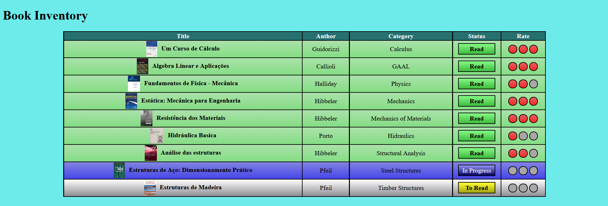

# Civil Engineering Course Book Inventory

> Built as part of the freeCodeCamp Responsive Web Design Certification.

## Overview
It's a page that shows an academic book inventory designed to meet a freeCodeCamp certification project's requirements. I am a civil engineering student and I included in the inventory the 9 most important books that i read/am going to read in my course. I have rated them based on their quality and on my experience with the subject at the time. There are currently three versions:

- **[showcase-version-that-passes-tests](showcase-version-that-passes-tests/)**
  My inventory with my opinions, 
  will pass all of freeCodeCamp tests but has less customization potential.

- **[blank-version](blank-version/)**
  A blank template that you can fill with books and then rate them. Will require you to edit the code to do that though.

- **[blank-imageless-version](blank-imageless-version/)**
  Same as blank version but doesnt have the "book-covers" folder nor the img elements in the html.

To make this project more interesting, I am planning on making an interactive version in the future that would allow you to rate the books on my list and also set your status on their readings. It would be still be pure css so it wouldn't be able to save progress, thus needing you to take a screenshot or something of the sort to keep track or share with someone.

## freeCodeCamp Modules Covered

### HTML

`Basic HTML` • `Semantic HTML` • `Forms and Tables` • `Accessibility`

### CSS

`Basic CSS` • `Design` • `Absolute and Relative Units` • `Pseudo Classes and Elements` • `Colors` • `Styling Forms` • `The Box Model` • `Flexbox` • `Typography` • `Accessibility` • `Positioning` • `Attribute Selectors`

## Design Decisions

This was THE attribute selectors certification project, so, naturally, it was quite restrictive. I made it about my academic books mostly to glaze Um Curso de Cálculo and show how important it was to me on a personal level for growth, but at the end I couldnt leave some of the other books at anything less than 3 circles... so now it looks like Um Curso de Cálculo is just another book in the pile. It's pretty good
